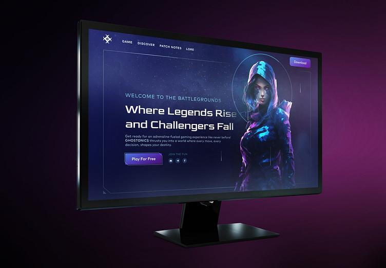

  

# 🎮 Brandon D. Coleman Jr. | My Gaming World

Welcome to **My Gaming World**, a personal website showcasing my interests in gaming, trucking simulators, roleplay communities, streaming, and web development.

## 🌐 About the Website

This website introduces visitors to my gaming interests, projects, gaming setup, and useful resources.

### Features

- 🎨 Modern dark-themed design with neon-inspired colors
- 🌓 Light and dark theme toggle
- 📱 Responsive layout for desktop, tablet, and mobile devices
- 🎮 Gaming sections featuring FiveM and multiplayer communities
- 🚛 American Truck Simulator (ATS) and Euro Truck Simulator 2 (ETS2)
- 💻 Web development and programming resources
- 🎥 Gaming and streaming information
- 🔗 Links to useful gaming and developer websites

## 🛠️ Built With

- HTML5
- CSS3
- JavaScript
- GitHub Pages

## 📂 Project Structure

my-gaming-world/
├── index.html
├── my-gaming-world-logo.jpg
├── README.md

## 🚀 View the Website

The website is designed to be hosted with GitHub Pages.

Once GitHub Pages is enabled, visit:

**https://brandoncoleman1.github.io/my-gaming-world/**

If your repository uses a different GitHub Pages URL, replace the link above with the published address shown in your repository's Pages settings.

## 🧑‍💻 Run Locally

1. Clone or download this repository.
2. Open the project folder.
3. Open `index.html` in your web browser.

No build tools or package installation are required.

## 🎯 Project Goals

This project is an opportunity to practice HTML, CSS, and JavaScript while building a personal website that reflects my gaming interests and development journey.

## 📚 Learning Resources

- [MDN Web Docs](https://developer.mozilla.org/)
- [GitHub](https://github.com/)
- [FiveM](https://fivem.net/)
- [American Truck Simulator](https://americantrucksimulator.com/)
- [Euro Truck Simulator 2](https://eurotrucksimulator2.com/)

## 👤 Author

**Brandon D. Coleman Jr.**

---

Thanks for visiting **My Gaming World**! 🎮
